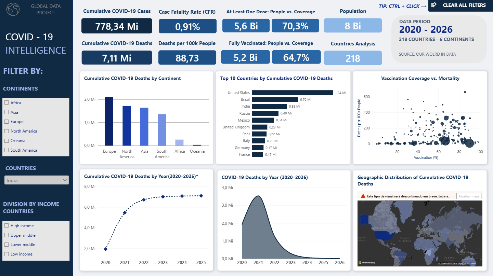

# COVID-19 Global Analytics

[**View Interactive Dashboard →**](https://app.powerbi.com/view?r=eyJrIjoiOGM1YzI4ZjAtODlmMS00ZDQxLWE1NzUtMjc2ZTRjNjJlNzcyIiwidCI6IjY1OWNlMmI4LTA3MTQtNDE5OC04YzM4LWRjOWI2MGFhYmI1NyJ9&embedImagePlaceholder=true&pageName=3f947c99ce99b001079b)

**Global Pandemic Trends | Vaccination Coverage | Health Outcomes**

## 1. Project Overview

An end-to-end data analytics project examining the evolution of COVID-19, vaccination progress, and health outcomes across **218 countries and territories**, from January 2020 to October 2026.

The project combines SQL-based data preparation and dimensional modeling in Google BigQuery with analytical modeling and interactive reporting in Power BI.

The objective is to transform large-scale epidemiological data into meaningful insights, enabling geographic comparisons and the assessment of health outcomes across different country income groups.

## 2. Business Questions

The analysis focuses on five key areas:

- **Pandemic Evolution:** How did confirmed cases and reported deaths evolve over time?
- **Geographic Impact:** Which countries and regions experienced the highest mortality levels?
- **Vaccination Progress:** How did vaccination coverage vary across countries and regions?
- **Income & Health Outcomes:** How did epidemiological indicators differ across country income groups?
- **Comparative Analysis:** How did vaccination coverage relate to reported deaths per 100,000 people?

## 3. Technology Stack

| Technology | Purpose |
|---|---|
| Google BigQuery | Cloud data warehouse |
| SQL | Data preparation, transformation, and dimensional modeling |
| Microsoft Power BI | Data modeling and interactive reporting |
| DAX | KPIs and analytical calculations |
| Power Query | Additional data preparation and transformations |

## 4. Data Sources & Architecture

**Primary Source:** [Our World in Data — COVID-19 Dataset](https://ourworldindata.org/covid-cases)

**Supporting Source:** Country income group classification.

The data architecture follows a dimensional modeling approach, separating descriptive attributes from daily epidemiological measurements.

**Core Data Model**

| Table | Description |
|---|---|
| `dim_geographic` | Country, continent, income group, and population attributes |
| `dim_date` | Calendar attributes for time-based analysis |
| `fact_covid_daily` | Daily COVID-19 and vaccination indicators |

**Fact Table Granularity:** One record per country per date.

**Final Dataset:** 536,675 records across 218 countries and territories.

## 5. Analytical Methodology

The analytical model applies aggregation rules according to the nature of each indicator:

| Metric | Calculation Approach |
|---|---|
| Cumulative cases and deaths | Latest valid value per country |
| Cumulative vaccination indicators | Latest valid value per country |
| New cases and deaths | Sum of daily values |
| Smoothed daily indicators | Average of daily values |
| Population-adjusted mortality | Deaths per 100,000 people |

**Key Performance Indicators**

- Cumulative COVID-19 Cases
- Cumulative COVID-19 Deaths
- Case Fatality Rate (CFR)
- Vaccination Coverage
- Fully Vaccinated Coverage
- Deaths per 100,000 People

## 6. Data Quality & Limitations

The final analytical model underwent structural and referential integrity checks.

| Validation | Result |
|---|---:|
| Fact records | 536,675 |
| Unique country-date combinations | 536,675 |
| Duplicate country-date combinations | 0 |
| Unmatched geographic or date keys | 0 |
| Countries and territories | 218 |

**Methodological Considerations**

- Missing observations are not automatically treated as zero.
- Reporting practices and data availability vary across countries.
- Historical figures may be subject to revisions.
- 2026 data covers only part of the year.
- Geographic population figures use 2025 as the reference year.
- CFR represents reported deaths relative to confirmed cases, not the Infection Fatality Rate (IFR).

The analysis identifies patterns and associations; it does not establish causal relationships.

## 7. Dashboard & Analysis

## Dashboard & Analysis

[View Interactive Dashboard — Power BI](SEU_LINK_PUBLICO)

### Global Overview

### COVID-19: Income & Health Outcomes

### Methodology & Data

The Power BI report is structured into three sections:

**Global Overview**
- Global pandemic trends and geographic comparisons.
- Mortality indicators and country rankings.
- Vaccination coverage and comparative analysis.

**Income & Health Outcomes**
- Health outcomes across country income groups.
- Vaccination coverage comparisons.
- Geographic and economic classification analysis.

**Methodology & Data**
- Data architecture and model relationships.
- KPI definitions and calculation criteria.
- Methodological decisions and limitations.

*Dashboard screenshots and key analytical findings will be included in this section.*

## 8. Repository Structure

The repository will contain the SQL scripts, Power BI report, technical documentation, and dashboard visuals.

The supporting files will be organized as the project documentation is completed.

## Author

**Felipe Guazzelli**

Data Analytics | Business Intelligence | Market Intelligence

**Technologies:** SQL · BigQuery · Power BI · DAX
